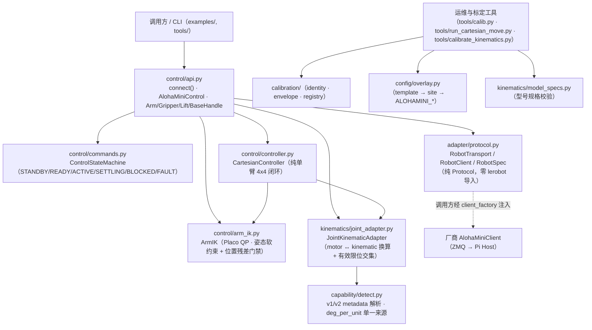

# AlohaMini Cartesian 架构一页图（Onboarding 入口）

本页是零上下文工程师的 **15 分钟接手入口**：讲清系统分层、模块职责、常见名词消歧与常用命令。

## 1 一句话目标

让 PC 上一段纯 Python 代码（`connect` / `move_to` / `move_by`）直接给 AlohaMini 2 Pro 下发笛卡尔位姿目标，替代原有的遥操作主臂（leader arm）；底层仍复用厂商 `lerobot_alohamini` Host 的串口总线、归一化协议与硬件保护，不修改厂商仓库与 Pi 侧部署。

## 2 分层架构与依赖边界



**三条硬边界（均由离线测试守卫）**：

1. **零 `lerobot` 导入**：`src/` 内任何文件都不 import `lerobot`（`tests/test_capability.py::test_no_module_outside_adapter_imports_lerobot`）；真实客户端只能由调用方通过 `connect(..., client_factory=...)` 注入。
2. **无跨帧平滑**：`src/` 内不引入 EMA / 低通 / slew 滤波（`tests/test_capability.py::test_v11_no_frame_smoothing_primitive_in_the_package`，见 `docs/ADR.md` D15）。
3. **fail-closed 与无伪填**：缺字段存 `None` 并报错或标注，不以 `0` 或 `4096` 猜默认值（唯一显式占位契约：`degrees` 归一化下三源皆空时 `Conversion` 回填 `0/0/1`）。

## 3 模块职责速查

| 目录 / 模块 | 职责 | 关键入口 |
| --- | --- | --- |
| `src/alohamini_cartesian/adapter/protocol.py` | 定义与厂商运行时接触的最小 `Protocol` 接口 | `RobotTransport`、`RobotClient`、`RobotSpec` |
| `src/alohamini_cartesian/capability/detect.py` | 解析观测帧 `_robot_metadata`（v1/v2），计算 `deg_per_unit`（全仓唯一公式来源） | `detect_from_observation`、`resolve_deg_per_unit` |
| `src/alohamini_cartesian/config/overlay.py` | 三层配置覆盖（默认 → `configs/template.yaml` → `configs/site.yaml` → `ALOHAMINI_*`） | `load_settings`、`AlohaMiniSettings` |
| `src/alohamini_cartesian/kinematics/` | 机械型号规格、URDF 资产与电机/运动学双向换算 | `validate_robot_model`、`JointKinematicAdapter` |
| `src/alohamini_cartesian/control/commands.py` | 监督状态机、分阶段互锁（`Stage.ARM` vs `Stage.BASE_LIFT`）与样本序号防回归 | `ControlStateMachine`、`ControlState`、`Stage` |
| `src/alohamini_cartesian/control/arm_ik.py` | 独立 6 自由度 Placo QP 逆运动学求解（缓存 URDF 限位与内存模型，软姿态约束） | `ArmIK`、`ArmKinematicProfile`、`IKResult` |
| `src/alohamini_cartesian/control/controller.py` | 纯单臂 4×4 位姿闭环控制器（步长门禁、领先量夹紧、跟随超时、过流退让） | `CartesianController`、`ControlError`、`CycleOutcome` |
| `src/alohamini_cartesian/control/api.py` | 高层会话入口：航点二分步进、姿态默认保持 / SO(3) 插值、双臂/夹爪/升降/底盘句柄 | `connect`、`AlohaMiniControl`、`ArmHandle` |
| `src/alohamini_cartesian/calibration/` | 标定代际身份（`calib_id`）、经验区间包络判定与代际登记表（`identity ← envelope` 单向依赖） | `identity.py`、`envelope.py`、`registry.py` |
| `tools/` | 现场运维与标定 CLI（统一标定入口、单位核对、`signs/zeros` 标定、`move_to` 驱动） | `calib.py`、`verify_unit_consistency.py`、`calibrate_kinematics.py`、`run_cartesian_move.py` |
| `benchmarks/` | 离线 IK 性能基准与现场观测 RTT / 单轴追踪探针（按 `_ml_impl/` 分模块维护） | `benchmarks/alohamini_ik/benchmark_arm_ik.py`、`benchmarks/alohamini_io/measure_latency.py` |

## 4 术语与编号体系消歧（高频踩坑）

仓库内有几组名字相近但含义完全不同的编号，阅读文档与代码时请按此表区分：

| 术语 / 编号 | 它是什么 | 不是什么 | 权威位置 |
| --- | --- | --- | --- |
| **V01–V13** | **现行**产品验收基线（每条含软件证据 + 实机证据 + 判据） | 不是旧仓库的 Gate 归档 | `docs/acceptance-baseline.md` |
| **D1–D25** | **现行**本库架构决策记录（ADR），按时间顺序追加 | 不是历史设计规范里的 `D001–D018` | `docs/ADR.md` |
| **Gate A–F** | **现行**基准脚本 `benchmarks/alohamini_io/measure_latency.py` 的 6 道运行时资格门禁 | 不是旧仓库按臂归档的 `Gate A–E` | `docs/field-ops/reference/gates.md` |
| **D001–D018 / Gate A–E** | 已退役旧仓库的历史设计编号与旧归档（仅作溯源参考，**无现行权威**） | 不能当现行验收或代码规范使用 | `docs/ADR.md` D4、D17 |
| **`signs` / `zeros`** | 本库 `JointKinematicAdapter` 消费的六关节方向（±1）与运动学零点（度） | 不是舵机固件的 `drive_mode` / `homing_offset`（tick），严禁混算 | `tools/calibrate_kinematics.py`、`docs/field-ops/runbook/4-experiments.md#exp-e8` |
| **`calib_id`** | 18 台电机 × 5 个核心标定字段规范 JSON 的 sha256 前 12 位（标定代际身份） | 不是 `file_sha256`（改格式/缩进就会变） | `src/alohamini_cartesian/calibration/identity.py` |

## 5 常用开发与验证命令

```bash
# 代码风格与格式检查（必须走 uv run --no-sync，避免生成 uv.lock）
uv run --no-sync ruff check .
uv run --no-sync ruff format --check .

# 离线全量测试（带实时汇总行）
uv run --no-sync python -m pytest tests -o addopts=""

# 离线 IK 性能基准（V13 预算门禁）
uv run --no-sync python benchmarks/alohamini_ik/benchmark_arm_ik.py --json

# 统一标定 CLI（离线只读示例）
uv run --no-sync python tools/calib.py --help
uv run --no-sync python tools/run_cartesian_move.py --dry-run --points 7 --out /tmp/move-dryrun.json
```

> 延伸阅读：接口与配置细节看 `docs/library-guide.md`，设计取舍看 `docs/ADR.md`，现场步骤看 `docs/field-ops/README.md`，当前未完待办看 `TODO.md`。
